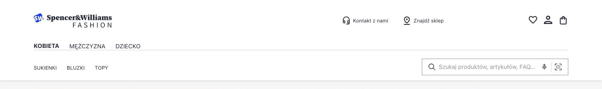
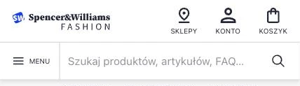
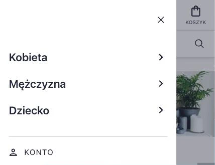

# Header Presta 2

A custom PrestaShop 8.2 header, built as a child theme of `classic`, plus a lightweight Google Analytics 4 module. Only the header is customized and the rest of the store is stock PrestaShop.

The design comes from the [Ecommerce Search & Discovery UI Kit](https://www.figma.com/community/file/981543186947734892/ecommerce-search-discovery-ui-kit) (Figma Community). The desktop (1440px) and mobile (375px) views are reproduced 1:1, and the layout scales fluidly between them.



<p>
  
  
</p>

## What's inside

- **`designpresta` theme**: the header, search bar, account, cart and main menu templates, with design tokens in CSS
- **`designmenu` module**: Women / Men / Kids switcher. Each section shows only the menu items assigned to it in the back office, and the section labels are translatable.
- **`designanalytics` module**: sends page views and `purchase` events to GA4 via `gtag.js`, using only two hooks (`displayHeader`, `displayOrderConfirmation`) and no core or theme changes. The measurement ID lives in `Configuration`, not in the code.

## Getting started

```bash
cp .env.example .env   # set DB_PASSWORD and DB_ROOT_PASSWORD
docker compose up -d
```

| Service | URL |
|---|---|
| Store | http://localhost:1001 |
| phpMyAdmin | http://localhost:1002 |

The installer runs in the browser. For the database step, use host `mysql`, the `DB_*` values from `.env` and the prefix `ps_`. Then:

```bash
docker exec presta2-shop rm -rf /var/www/html/install
docker exec presta2-shop sh -c 'ls -d /var/www/html/admin*'   # back office folder
```

## Setup after install

The repo ships no DB dump, so a fresh install starts with the demo catalog:

1. **Theme:** enable *Design Presta* in *Design → Theme & Logo*.
2. **Modules:** install both modules:
   ```bash
   docker exec presta2-shop php bin/console prestashop:module install designmenu
   docker exec presta2-shop php bin/console prestashop:module install designanalytics
   ```
3. **Menu:** add categories to the *Main menu* module, then assign menu items to each section in *Design Menu → Configure*.
4. **Analytics:** paste a GA4 measurement ID (`G-XXXXXXXXXX`) in *Design Analytics → Configure* and enable it. *Debug mode* marks hits for GA4 DebugView.
5. **Clear the cache** after switching the theme or installing modules. Otherwise some strings stay untranslated:
   ```bash
   docker exec presta2-shop sh -c 'rm -rf /var/www/html/var/cache/*'
   ```

While working on templates, disable the CSS, JS and Smarty caches in *Advanced Parameters → Performance*. Turn them back on for production.

## Notes

- Only `prestashop/themes/`, `modules/` and `override/` are tracked. The PrestaShop core comes from the pinned Docker image.
- PrestaShop 8.2 supports PHP up to 8.1, which is end-of-life and has no official release fixing CVE-2026-109618 and CVE-2026-109619 (unauthenticated RCE). `docker/prestashop/Dockerfile` rebuilds PHP 8.1 and its extensions from the security team's backport branch `PHP-8.1-CVE-2026-109618-109619` in php-src, so the first `docker compose up` compiles PHP and takes several minutes. The long-term fix is moving to PrestaShop 9 on a supported PHP.
- The database lives in the `mysql_data` volume, which survives `docker compose down` but not `down -v`.
- Out of scope: `view_item`, `add_to_cart` and cookie consent.
